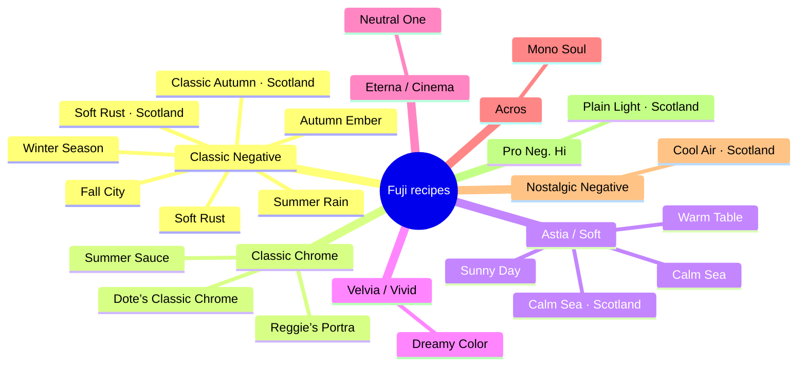

# Recipe mind map

Reviewed 2026-10-22 (Soft Rust autumn carousel); other recipes retain prior reviews. All 19 recipes share this structure: intent → subjects → light → palette → observed references → cautions → related choices → preview assumptions. Source settings remain authoritative; observations are not calibrated transforms.

## Winter Season

**Intent:** An earthy everyday interpretation: Classic Negative with Color +3 separates foliage and warm wood; 5600K and R -4 / B -5 deliberately alter daylight color while Strong Large grain adds obvious texture. The catalog records a creator rename from Kodak Portra 800 and a quarter Black Mist filter.

**Subjects:** street, forest, interior, still-life

**Light to consider:** daylight, overcast

**Palette:** green, orange, yellow, neutral

**Observed references:** Potted foliage and paper cups on warm timber; deep leafy shadows and textured, earthy midtones.

**Caution:** Highlight +1 can make bright windows or pale skin more abrupt. The fixed white balance will not neutralize mixed lighting, and grain alone cannot reproduce the recorded Black Mist diffusion.

**Preview assumptions:** Use the saved film simulation, WB and tone settings for an approximate sRGB preview. Highlight +1 can make bright windows or pale skin more abrupt. The fixed white balance will not neutralize mixed lighting, and grain alone cannot reproduce the recorded Black Mist diffusion.

**Evidence:** settings-inference · Reference appearance is observed; suitability and causal rendering remain interpretations. No paired untreated images or calibrated camera response.

**Related:** Less grain and more forgiving skin from Reggie’s; Winter favors earthy texture.

## Soft Rust

**Intent:** A dense rust-and-foliage interpretation. Classic Negative, R +6 / B -6 and Color +4 emphasize earthy warm/cool separation; Shadow +2 creates darker hills and DR100 leaves a firmer contrast budget. Clarity -4 softens detail without lifting the shadows.

**Subjects:** landscape, forest, architecture, street

**Light to consider:** daylight, golden

**Palette:** orange, red, yellow, green

**Observed references:** Alpine reference: warm grass against dense trees and mountains; pale clouds above dark land.

**Caution:** DR100 affords less highlight protection than the separate Scotland variant; bright skies need careful exposure. Shadow +2 can crush dark trees, and the large color shift is less suited to neutral product or skin rendering.

**Preview assumptions:** Use the saved film simulation, WB and tone settings for an approximate sRGB preview. DR100 affords less highlight protection than the separate Scotland variant; bright skies need careful exposure. Shadow +2 can crush dark trees, and the large color shift is less suited to neutral product or skin rendering.

**Evidence:** settings-inference · Reference appearance is observed; suitability and causal rendering remain interpretations. No paired untreated images or calibrated camera response.

**Related:** This earlier variant has DR100 and NR -4; Scotland has DR400 and NR 0.

## Fall City

**Intent:** A grain-free autumn city interpretation inferred from the supplied fall post. Classic Negative, R +4 / B -5 and Color +3 favor brick, warm foliage and street color; DR200 with Highlight -2 keeps lighter surfaces gentler while Shadow +1 adds depth.

**Subjects:** street, architecture, forest, festival

**Light to consider:** daylight, golden

**Palette:** orange, red, yellow, green

**Observed references:** Coffee cup, hand and warm table: cream foam, warm brown surroundings and shadow depth.

**Caution:** Fall City is a catalog title, not a verified creator recipe name. NR and Clarity remain unspecified; do not assume missing settings are zero. Warm shifts can distort branded or color-critical subjects.

**Preview assumptions:** Use the saved film simulation, WB and tone settings for an approximate sRGB preview. Fall City is a catalog title, not a verified creator recipe name. NR and Clarity remain unspecified; do not assume missing settings are zero. Warm shifts can distort branded or color-critical subjects.

**Evidence:** settings-inference · Reference appearance is observed; suitability and causal rendering remain interpretations. No paired untreated images or calibrated camera response.

**Related:** Fall City adds Classic Negative character; Warm Table favors food texture with Astia.

## Autumn Ember

**Intent:** A vivid foliage interpretation. Classic Negative with fixed 6300K, R +2 / B -6 and Color +4 favors amber and red leaves; strong Chrome and FX Blue support separation from dense skies. DR400 and Highlight -1 soften brighter areas while Clarity -4 softens texture.

**Subjects:** forest, landscape, flowers

**Light to consider:** daylight, golden

**Palette:** red, orange, yellow, green, blue

**Observed references:** Orange-red leaves against a cool blurred background; strong separation and a distinct autumn accent.

**Caution:** Fixed 6300K can strongly warm tungsten or late-day skin. Creator notes include ND and Black Mist on X-T5; neither filter’s effect is reproduced by the settings. Keep exposure within highlight limits rather than blindly using +1.

**Preview assumptions:** Use the saved film simulation, WB and tone settings for an approximate sRGB preview. Fixed 6300K can strongly warm tungsten or late-day skin. Creator notes include ND and Black Mist on X-T5; neither filter’s effect is reproduced by the settings. Keep exposure within highlight limits rather than blindly using +1.

**Evidence:** settings-inference · Reference appearance is observed; suitability and causal rendering remain interpretations. No paired untreated images or calibrated camera response.

**Related:** Ember favors vivid foliage; Classic Autumn uses lower Color for quieter moor scenes.

## Summer Rain

**Intent:** An overcast-portrait interpretation supported by the catalog’s creator note. Classic Negative, Daylight WB with R -2 / B -1 and Color +4 give a less red-biased alternative to warm recipes. DR400 and Highlight -2 soften bright skin while Shadow +0.5 retains mild depth.

**Subjects:** portrait, street, forest

**Light to consider:** overcast, daylight

**Palette:** green, blue, red, neutral

**Observed references:** White blossoms against clear blue sky; bright petals and stronger color. Portrait intent comes from source notes, not this flower alone.

**Caution:** Shadow +0.5 adds contrast rather than lifting shadows, despite the short catalog description. Strong color and Chrome effects can still exaggerate clothing or lips; Daylight WB is less flexible under mixed artificial light.

**Preview assumptions:** Use the saved film simulation, WB and tone settings for an approximate sRGB preview. Shadow +0.5 adds contrast rather than lifting shadows, despite the short catalog description. Strong color and Chrome effects can still exaggerate clothing or lips; Daylight WB is less flexible under mixed artificial light.

**Evidence:** settings-inference · Reference appearance is observed; suitability and causal rendering remain interpretations. No paired untreated images or calibrated camera response.

**Related:** Summer Rain gives Classic Negative color; Reggie’s is a softer adaptive-WB portrait alternative.

## Classic Autumn · Scotland

**Intent:** A lower-saturation autumn moor alternative to the Rust recipes. Classic Negative with Color 0 preserves a calmer palette while R +6 / B -6 warms rust tones; DR400, Highlight -1.5 and Shadow +0.5 balance bright haze against gentle shadow depth. Strong Large grain and Clarity -3 add visible texture with softer definition.

**Subjects:** landscape, forest, architecture

**Light to consider:** overcast, fog

**Palette:** orange, red, yellow, neutral

**Observed references:** Same valley: muted rust moor, pinkish pale mist, dark slopes and a small white house.

**Caution:** Large grain is conspicuous in pale haze; Auto WB’s strong shift may make skies pink. This is not Soft Rust: lower Color and milder shadows substantially change intent. The +1/3 compensation is a starting point, not a highlight guarantee.

**Preview assumptions:** Use the saved film simulation, WB and tone settings for an approximate sRGB preview. Large grain is conspicuous in pale haze; Auto WB’s strong shift may make skies pink. This is not Soft Rust: lower Color and milder shadows substantially change intent. The +1/3 compensation is a starting point, not a highlight guarantee.

**Evidence:** settings-inference · Reference appearance is observed; suitability and causal rendering remain interpretations. No paired untreated images or calibrated camera response.

**Related:** Color 0 and milder shadows give a quieter alternative to the richer Soft Rust variant.

## Soft Rust · Scotland — October 10 Brittany autumn carousel update

**Intent:** Earthy, cinematic seasonal color for hazy winter Kolkata streets, overcast portraits and atmospheric travel. Preserve orange/rust subject separation against muted blue-grey and pink-grey background. This is the existing DR400 Soft Rust · Scotland variant, **not** the earlier DR100 Soft Rust.

**Observed photographs:** Orange knit hat with lighthouse; dark camper van against yellow trees; foggy sea stacks; sandy coast framed by vehicle interior; two people against a rocky shore; warm sunset on cliffs; wide coastal lighthouse. These are user-supplied finished-reference screenshots; new square crops are prepared separately and not yet committed to the app.

**Scene decision:** Favor overcast, shade, winter haze, golden side-light, environmental portraits, old streets, textured architecture and travel landscapes. Avoid accurate skin-color work and strongly mixed artificial light. Use a subject-focused exposure check: source settings slide suggests -2/3 to 0 EV while caption suggests +1/3 to +1 EV; retain both with attribution.

**Camera practicality:** Auto WB with R+6/B-6, DR400 (ISO floor applies), strong/small grain and Clarity -4 (potential capture delay). For November–December, seasonal C2 replacement for Fall City; C1 Reggie's Portra and C4 personal portrait slot stay intact.

**Mind-map edges:** Soft Rust · Scotland → [overcast, fog, golden] → [street, portrait, architecture, forest, coast] → [rust, ochre, muted green, cyan-grey, pink-grey] → [nostalgic, warm, atmospheric] → [risk: orange skin, clipped bright rocks, crushed shadows, slow clarity].

## Soft Rust · Scotland

**Intent:** The Scotland-specific dense warm-moor interpretation: Classic Negative with R +6 / B -6, Color +4 and Shadow +2 makes amber land stand against dark hills, while Clarity -4 softens detail. DR400 provides more highlight margin than earlier Soft Rust; NR 0 and -2/3 to 0 compensation are also distinct.

**Subjects:** landscape, forest, architecture

**Light to consider:** overcast, daylight

**Palette:** orange, red, yellow, green

**Observed references:** Same valley: dense hills and richer amber foreground under pale mist; dark areas need protection.

**Caution:** Keep the Scotland variant distinct: earlier Soft Rust uses DR100 and NR -4. DR400 does not prevent deep shadows from blocking with Shadow +2 and negative exposure; check detail in trees and hills.

**Preview assumptions:** Use the saved film simulation, WB and tone settings for an approximate sRGB preview. Keep the Scotland variant distinct: earlier Soft Rust uses DR100 and NR -4. DR400 does not prevent deep shadows from blocking with Shadow +2 and negative exposure; check detail in trees and hills.

**Evidence:** settings-inference · Reference appearance is observed; suitability and causal rendering remain interpretations. No paired untreated images or calibrated camera response.

**Related:** Stronger Color and Shadow make this denser; Classic Autumn protects a calmer palette.

## Reggie’s Portra

**Intent:** A versatile family, portrait and travel look grounded in the creator’s own Portra scans and Filipino family skin tones. Classic Chrome, Auto WB with R +2 / B -4, softened Highlight -1 / Shadow -1 and Color +2 balance a gentle warm palette with readable everyday detail.

**Subjects:** portrait, street, interior, night, landscape, festival

**Light to consider:** daylight, overcast, mixed

**Palette:** orange, yellow, green, blue, neutral

**Observed references:** Sydney waterfront reference: pale architecture, subdued water and sky. Creator evidence additionally supports family and skin.

**Caution:** The creator uses a CineBloom diffusion filter; Clarity 0 does not recreate that optical glow. Judge exposure per scene instead of treating the catalog +1/3 to +1 range as mandatory, especially on bright skin and windows.

**Preview assumptions:** Use the saved film simulation, WB and tone settings for an approximate sRGB preview. The creator uses a CineBloom diffusion filter; Clarity 0 does not recreate that optical glow. Judge exposure per scene instead of treating the catalog +1/3 to +1 range as mandatory, especially on bright skin and windows.

**Evidence:** creator · Reference appearance is observed; suitability and causal rendering remain interpretations. No paired untreated images or calibrated camera response.

**Related:** Auto WB adapts to changing light; Dote fixes daylight and pushes stronger amber warmth.

## Summer Sauce

**Intent:** A warm, low-contrast landscape interpretation. Classic Chrome with DR400, Highlight -2 and Shadow -2 preserves a gentle tonal relationship; R +3 / B -6 and Color +4 favor amber earth against cooler sky, with Clarity -4 reducing definition.

**Subjects:** landscape, forest, coast, street

**Light to consider:** daylight, golden

**Palette:** orange, yellow, green, blue

**Observed references:** Alpine scene: warm meadow, darker green trees and blue mountain/cloud separation; gently softened tones.

**Caution:** Strong warmth may discolor neutral architecture or skin. Softened shadows can look flat in already misty light; the catalog records the creator’s optional Shadow 0, but recommendations retain the saved -2.

**Preview assumptions:** Use the saved film simulation, WB and tone settings for an approximate sRGB preview. Strong warmth may discolor neutral architecture or skin. Softened shadows can look flat in already misty light; the catalog records the creator’s optional Shadow 0, but recommendations retain the saved -2.

**Evidence:** settings-inference · Reference appearance is observed; suitability and causal rendering remain interpretations. No paired untreated images or calibrated camera response.

**Related:** Summer Sauce is gentler in color than Velvia-based Dreamy Color.

## Dote’s Classic Chrome

**Intent:** A warm documentary treatment for everyday objects, interiors and daylight city scenes: cream highlights, amber wood and skin against charcoal or brown shadows, with orange accents retaining presence. The seven supplied references support tactile surfaces and window-light geometry. Daylight WB R +2 / B -6, Classic Chrome, Color +2 and softened Highlight / Shadow -1 support this interpretation; they do not establish a calibrated transform.

**Subjects:** still-life, interior, architecture, street, portrait, landscape

**Light to consider:** daylight, golden

**Palette:** orange, yellow, neutral, green, blue

**Observed references:** Seven user-approved screenshots: cream wall, warm wood, charcoal felt, pale gray gear, skin, orange drive and a city view. Strong window-light geometry and dense warm shadows recur.

**Caution:** Already-warm light may over-amber skin and whites. Deep source shadows can remain dense despite Shadow -1. Fixed Daylight WB is less adaptable to artificial/mixed light. Grain size, FX Blue and Clarity are unspecified. Orange title text is an overlay, not scene color evidence; do not use it to calibrate the look.

**Preview assumptions:** Use the saved film simulation, WB and tone settings for an approximate sRGB preview. Catalog samples are small regions of title cards, not a comprehensive clean gallery. Grain size, FX Blue and Clarity are unspecified. Suggested +2/3 to +1 exposure can clip important whites; meter the actual scene.

**Evidence:** user-approved-references · Reference appearance is observed; suitability and causal rendering remain interpretations. No paired untreated images or calibrated camera response.

**Related:** Dote favors fixed daylight amber atmosphere and tactile objects; Reggie’s adapts better to changing light.

## Sunny Day

**Intent:** A clean, grain-free daylight option. Astia, DR400 and Highlight -1.5 soften bright detail while Shadow +2 adds structure; Color +3 strengthens sunlit clothes, buildings and greenery. Fixed 4600K is cooler than a typical daylight balance before the small B -1 shift.

**Subjects:** portrait, street, architecture, coast, festival

**Light to consider:** daylight

**Palette:** blue, green, orange, yellow

**Observed references:** Sunlit guitarist, cream clothing, warm skin and green surroundings; hard daylight gives subject shape.

**Caution:** Do not infer universally warm skin from the title: 4600K depends on actual light. Shadow +2 may obscure faces in shade; DR400 needs ISO 640 or above on X-S20.

**Preview assumptions:** Use the saved film simulation, WB and tone settings for an approximate sRGB preview. Do not infer universally warm skin from the title: 4600K depends on actual light. Shadow +2 may obscure faces in shade; DR400 needs ISO 640 or above on X-S20.

**Evidence:** settings-inference · Reference appearance is observed; suitability and causal rendering remain interpretations. No paired untreated images or calibrated camera response.

**Related:** Sunny Day uses stronger color and deeper shadows; Plain Light is more restrained.

## Calm Sea

**Intent:** An Astia-based soft landscape alternative with Shade WB and B +1, Color +2 and reduced Clarity -4. DR400 moderates highlight loss but Highlight +2 restores bright tonal punch; weak FX Blue keeps blue separation subtler than the strong-blue recipes.

**Subjects:** coast, landscape, forest

**Light to consider:** daylight, overcast

**Palette:** blue, cyan, orange, green

**Observed references:** Alpine reference pairs blue sky and cool mountain faces with a yellow meadow; not evidence of a sea-specific restriction.

**Caution:** Shade WB is a warm compensation preset, not proof of a cold result. Highlight +2 can harden clouds despite the name. This earlier entry has ISO up to 6400 and unspecified compensation; preserve its own identity.

**Preview assumptions:** Use the saved film simulation, WB and tone settings for an approximate sRGB preview. Shade WB is a warm compensation preset, not proof of a cold result. Highlight +2 can harden clouds despite the name. This earlier entry has ISO up to 6400 and unspecified compensation; preserve its own identity.

**Evidence:** settings-inference · Reference appearance is observed; suitability and causal rendering remain interpretations. No paired untreated images or calibrated camera response.

**Related:** Settings are close, but exposure and ISO guidance differ; preserve separate identities.

## Warm Table

**Intent:** A food-oriented interpretation from the supplied cooking post. Astia with 5800–7000K and R +2 / B -1 favors inviting golden dishes; Highlight -2 moderates glossy highlights, Shadow +1 adds volume, and Sharpness +1 / Clarity +1 preserve food texture without extra Color.

**Subjects:** food, still-life, interior

**Light to consider:** daylight, artificial

**Palette:** orange, yellow, red, green, neutral

**Observed references:** Close food preparation sample: tofu, greens, sauce and fingers; ingredient texture remains important.

**Caution:** Warm Table is a catalog name; the source post has no recipe name. The broad Kelvin range is not one fixed recipe output. Warm balance can make whites yellow; DR100 requires care with glossy plates and bright windows. Missing grain/Chrome settings stay unspecified.

**Preview assumptions:** Use the saved film simulation, WB and tone settings for an approximate sRGB preview. Warm Table is a catalog name; the source post has no recipe name. The broad Kelvin range is not one fixed recipe output. Warm balance can make whites yellow; DR100 requires care with glossy plates and bright windows. Missing grain/Chrome settings stay unspecified.

**Evidence:** settings-inference · Reference appearance is observed; suitability and causal rendering remain interpretations. No paired untreated images or calibrated camera response.

**Related:** Warm Table emphasizes food detail; Fall City provides a more stylized everyday palette.

## Calm Sea · Scotland

**Intent:** The separate Scotland post’s soft Astia landscape interpretation, paired with cold sky and amber moor in the catalog. Shade WB / B +1, DR400, Highlight +2, Color +2 and Clarity -4 keep the underlying settings close to Calm Sea, but this entry specifically records exposure -1/3 to 0.

**Subjects:** coast, landscape, forest

**Light to consider:** overcast, fog, daylight

**Palette:** blue, cyan, orange, yellow

**Observed references:** Misty mountain valley: gray sky, dark cool slopes, amber moor and small pale house; keep atmospheric separation.

**Caution:** Do not merge it with Calm Sea: exposure guidance and ISO text differ. Shade WB need not render cool, and Highlight +2 makes pale mist and clouds sensitive to exposure despite DR400.

**Preview assumptions:** Use the saved film simulation, WB and tone settings for an approximate sRGB preview. Do not merge it with Calm Sea: exposure guidance and ISO text differ. Shade WB need not render cool, and Highlight +2 makes pale mist and clouds sensitive to exposure despite DR400.

**Evidence:** settings-inference · Reference appearance is observed; suitability and causal rendering remain interpretations. No paired untreated images or calibrated camera response.

**Related:** Astia offers a different sky/land relationship from the warmer Classic Negative interpretation.

## Dreamy Color

**Intent:** Expressive rather than neutral landscape color: Velvia and Color +4 favor strong foliage, flowers and sky; R +6 / B -5 adds warmth, strong Chrome effects deepen saturated colors, while Highlight -1, Shadow -1.5 and Clarity -4 soften tonal and textural edges.

**Subjects:** landscape, flowers, forest, coast

**Light to consider:** daylight, overcast

**Palette:** green, blue, purple, orange, red

**Observed references:** Same alpine composition: pronounced green/yellow meadow and violet-pink cloud color; expressive rather than neutral.

**Caution:** Velvia plus maximum color and a strong WB shift can overpower already saturated flowers or skin. Strong FX Blue can make skies dense. A soft look does not imply low saturation.

**Preview assumptions:** Use the saved film simulation, WB and tone settings for an approximate sRGB preview. Velvia plus maximum color and a strong WB shift can overpower already saturated flowers or skin. Strong FX Blue can make skies dense. A soft look does not imply low saturation.

**Evidence:** settings-inference · Reference appearance is observed; suitability and causal rendering remain interpretations. No paired untreated images or calibrated camera response.

**Related:** Dreamy Color prioritizes vivid hue; Summer Sauce offers a calmer Chrome interpretation.

## Neutral One

**Intent:** A restrained Eterna foundation for a cinematic everyday or landscape alternative. Auto WB with R +4 / B -4 and Color +4 deliberately warms and strengthens Eterna’s subdued baseline; Shadow +2 supplies depth while Clarity -4 softens local detail.

**Subjects:** landscape, street, architecture, interior, portrait

**Light to consider:** daylight, overcast

**Palette:** neutral, orange, green, blue

**Observed references:** Alpine reference has subdued sky and dense hills with a warm foreground; the name does not promise neutral WB.

**Caution:** The name does not mean color-neutral: the WB shift is substantial and maximum Color modifies Eterna. DR100 and Shadow +2 are riskier for backlit portraits than softer DR400 options.

**Preview assumptions:** Use the saved film simulation, WB and tone settings for an approximate sRGB preview. The name does not mean color-neutral: the WB shift is substantial and maximum Color modifies Eterna. DR100 and Shadow +2 are riskier for backlit portraits than softer DR400 options.

**Evidence:** settings-inference · Reference appearance is observed; suitability and causal rendering remain interpretations. No paired untreated images or calibrated camera response.

**Related:** Eterna and strong WB shift offer a moodier interpretation than Plain Light.

## Mono Soul

**Intent:** A high-contrast monochrome choice for daily life, texture and expressive portraits. The creator’s Fujifilm story values tonal depth and silver-halide character; catalog DR400, Highlight +2 and Shadow +3 create strong tonal separation. Use shape and luminance rather than palette matching.

**Subjects:** street, portrait, architecture, still-life, night

**Light to consider:** daylight, artificial, night

**Palette:** neutral

**Observed references:** Dark working interior: a person, side light and surfaces separated by luminance; color is not the story.

**Caution:** Color is discarded; avoid this when colorful clothing or festival color carries the story. The published creator story specifies ACROS+G while the saved catalog says Acros; keep the saved source unchanged and do not claim exact green-filter parity.

**Preview assumptions:** Use the saved film simulation, WB and tone settings for an approximate sRGB preview. Color is discarded; avoid this when colorful clothing or festival color carries the story. The published creator story specifies ACROS+G while the saved catalog says Acros; keep the saved source unchanged and do not claim exact green-filter parity.

**Evidence:** creator · Reference appearance is observed; suitability and causal rendering remain interpretations. No paired untreated images or calibrated camera response.

**Related:** Mono Soul discards hue; Neutral One retains subdued cinematic color.

## Cool Air · Scotland

**Intent:** A dramatic mist-and-hills interpretation using Nostalgic Negative’s amber highlight foundation with R -1 / B -3, Color +4 and strong Chrome. Highlight +1.5 and Shadow +3 create pronounced tonal separation; Clarity -3 softens texture without undoing that contrast.

**Subjects:** landscape, forest, coast, snow

**Light to consider:** overcast, fog

**Palette:** blue, cyan, neutral, orange

**Observed references:** Same valley: blue/cyan upper slopes and mist contrast with brown foreground; very deep hill shadows.

**Caution:** The Cool Air name is not a globally cool WB: B -3 reduces blue and Nostalgic Negative has amber highlights. Shadow +3 can lose dark hill detail; high highlight contrast may make bright snow harsh despite DR400.

**Preview assumptions:** Use the saved film simulation, WB and tone settings for an approximate sRGB preview. The Cool Air name is not a globally cool WB: B -3 reduces blue and Nostalgic Negative has amber highlights. Shadow +3 can lose dark hill detail; high highlight contrast may make bright snow harsh despite DR400.

**Evidence:** settings-inference · Reference appearance is observed; suitability and causal rendering remain interpretations. No paired untreated images or calibrated camera response.

**Related:** Cool Air adds stronger tonal drama; Plain Light keeps a more restrained everyday balance.

## Plain Light · Scotland

**Intent:** The closest restrained everyday alternative in the Scotland set. Pro Neg. Hi, Auto WB with a small R +1 / B -1 shift, Color +1 and grain Off support believable skin and landscape color; DR200 / Highlight -0.5 modestly protect light detail while Shadow +1 adds form.

**Subjects:** portrait, landscape, street, architecture, animals, food

**Light to consider:** overcast, daylight, mixed

**Palette:** neutral, green, blue, orange

**Observed references:** Same valley: gray mist, brown moor and restrained color with readable pale house; less amber than the warm variants.

**Caution:** This is an inference from settings and the catalog’s grey-mist sample pairing, not a promise of calibrated color. Pro Neg. Hi and Shadow +1 still add contrast; it is not identical to Pro Neg. Std or a flat grading profile.

**Preview assumptions:** Use the saved film simulation, WB and tone settings for an approximate sRGB preview. This is an inference from settings and the catalog’s grey-mist sample pairing, not a promise of calibrated color. Pro Neg. Hi and Shadow +1 still add contrast; it is not identical to Pro Neg. Std or a flat grading profile.

**Evidence:** settings-inference · Reference appearance is observed; suitability and causal rendering remain interpretations. No paired untreated images or calibrated camera response.

**Related:** Plain Light favors restraint and believable skin; Cool Air pushes dramatic contrast.

